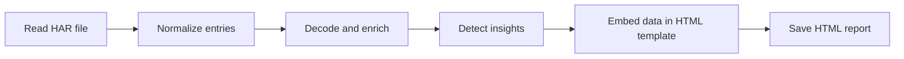

# HAR2HTML

A PowerShell tool that converts a browser **HAR trace** (Edge, Chrome, Firefox or other HAR export) into a single, self-contained, offline **HTML report** with a classic HTTP debugging proxy layout. It decodes every request and response and flags common web, authentication and API problems.

---

## Table of Contents

- [Key Features](#key-features)
- [How It Works](#how-it-works)
- [Requirements](#requirements)
- [Usage](#usage)
- [Parameters](#parameters)
- [Output](#output)
- [Security & Privacy](#security--privacy)
- [Disclaimer](#disclaimer)

---

## Key Features

- **Session-based UI:** left tabs (Sessions, Summary, Timeline, Insights, Capture info), a sessions grid with per-column filters, and Request and Response inspectors (Headers, TextView, WebForms, JSON, XML, Cookies, Auth, SAML, Raw, Hex, Preview, Timing, Redirects, Caching, WebSocket).
- **Full decoding:** base64, gzip/deflate/brotli (brotli on PowerShell 7+), URL-encoded forms, multipart, JSON, XML, JWT, SAML, cookies, WebSocket frames and binary (hex view).
- **Global search** across URLs, headers and bodies with yellow row highlighting and next/previous navigation.
- **Insights:** HTTP errors, failed requests, AADSTS codes, OAuth errors, expired JWTs, CORS issues, slow TTFB, redirect loops and more.
- **Troubleshooting tools:** summary dashboard, waterfall timeline, redirect chains, correlation IDs (**Correlation ID** and **x-ms-request-id** columns, hidden by default and enabled via **Columns**; the Correlation ID column also picks up `correlationId` GUIDs from response and request bodies), session compare, export (CSV, session text, HAR), and a right-click menu with Copy as cURL (bash), Copy as cURL (PowerShell) and Copy as PowerShell.
- **Find in pane:** a search box above each Request and Response pane highlights matches in the open tab in yellow (Enter = next, Shift+Enter = previous, Esc = clear).
- **Damaged HAR recovery:** if a HAR file is truncated, the entries up to the last complete one are still converted and a warning is shown.
- **Single file output:** all CSS, JavaScript and data are embedded. No internet access or external libraries needed.

## How It Works



## Requirements

- **Windows PowerShell 5.1** or later (PowerShell 7+ also supported; Brotli decoding needs PowerShell 7+).
- No external modules.
- A modern browser (Edge, Chrome or Firefox) to view the report.

## Usage

**Basic:**
```powershell
.\HAR2HTML.ps1 -HarPath "C:\temp\trace.har"
```

**Choose the output folder and open the report when done:**
```powershell
.\HAR2HTML.ps1 -HarPath "C:\temp\trace.har" -OutputPath "C:\temp\Reports" -Open
```

**Mask secrets for sharing (permanent, cannot be undone in the report):**
```powershell
.\HAR2HTML.ps1 -HarPath "C:\temp\trace.har" -RedactSecrets
```

## Parameters

| Parameter | Type | Description |
|-----------|------|-------------|
| `-HarPath` | string | Path to a single `.har` file. Required. Alias: `-Path`. ZIP-based archives (for example `.saz`) are rejected. |
| `-OutputPath` | string | Folder or file path for the HTML report. Aliases: `-OutPut`, `-OutputFolder`, `-OutDir`. Defaults to the HAR file's folder. A file path without `.htm` or `.html` gets `.html` appended. |
| `-Open` | switch | Opens the report in the default browser when finished. |
| `-RedactSecrets` | switch | Permanently masks authorization headers, cookies, tokens, passwords, client secrets and SAML assertions while the report is generated. Without it, nothing is masked. |

## Output

The report is saved as `<HarName>_Report_<yyyyMMdd_HHmmss>.html` (or under the exact file name when `-OutputPath` is a file) and shows the generation time in its header. The console prints the number of entries, the error count (4xx/5xx/failed), the output path and the processing time.

Exit codes: `0` success, `1` invalid input (missing, empty, ZIP-based archive, not a HAR, or unsupported HAR version), `2` parse or conversion failure (for example invalid JSON). Errors are printed as `ERROR: ...`.

## Security & Privacy

- HAR content is treated as untrusted: everything rendered is HTML-escaped, the report uses a Content Security Policy that allows only its own script (by SHA-256 hash) and sets `form-action 'none'` and `base-uri 'none'`, and HTML previews run in a sandboxed iframe.
- The script makes no network calls. Its only output is the HTML report.
- Text bodies larger than 5 MB are truncated in the report; larger binary bodies are not embedded.
- **Without `-RedactSecrets` the report contains passwords, tokens, cookies and secrets unmasked.** With it, secrets are masked at generation time (short values and all passwords and secrets are masked completely, longer values keep at most 4 characters at each end) and the original values are not stored in the file, so they cannot be revealed later. There is no on-screen redact button. Insight texts, error text and page titles are masked too, and decoded JWT claims and SAML XML are withheld. Masking is name-based, so check a redacted report before sharing it.
- **HAR files and reports may contain sensitive data** (tokens, cookies, personal data). Use `-RedactSecrets` before sharing and share them only through approved channels.

## Disclaimer

This script has been tested across various scenarios. By using it, you accept responsibility for how you use it and its outcomes, and the entire risk of its use remains with you. The author and contributors are not liable for any damages, including data loss or business interruption.
