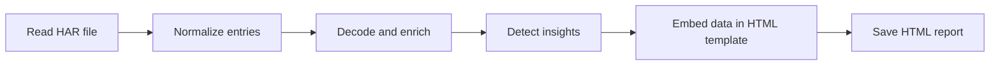

# HAR2HTML

A PowerShell tool that converts a browser **HAR trace** (Edge, Chrome, Firefox or other HAR export) into a single, self-contained, offline **HTML report** with a classic HTTP debugging proxy layout. It decodes every request and response and flags common web, authentication and API problems.

---

## Table of Contents

- [Key Features](#key-features)
- [How It Works](#how-it-works)
- [Requirements](#requirements)
- [Usage](#usage)
- [Parameters](#parameters)
- [Output](#output)
- [Security & Privacy](#security--privacy)
- [Disclaimer](#disclaimer)

---

## Key Features

- **Session-based UI:** sessions grid with per-column filters, plus Request and Response inspectors (Headers, TextView, WebForms, JSON, XML, Cookies, Auth, SAML, Raw, Hex, Preview, Timing).
- **Full decoding:** base64, gzip/deflate/brotli, URL-encoded forms, multipart, JSON, XML, JWT, SAML, cookies and binary (hex view).
- **Global search** across URLs, headers and bodies with yellow row highlighting and next/previous navigation.
- **Insights:** HTTP errors, failed requests, AADSTS codes, OAuth errors, expired JWTs, CORS issues, slow TTFB, redirect loops and more.
- **Troubleshooting tools:** summary dashboard, waterfall timeline, redirect chains, correlation IDs, session compare, export (CSV, TXT, HAR), copy as cURL/PowerShell.
- **Single file output:** all CSS, JavaScript and data are embedded. No internet access or external libraries needed.

## How It Works



## Requirements

- **Windows PowerShell 5.1** or later (PowerShell 7+ also supported; Brotli decoding needs PowerShell 7+).
- No external modules.
- A modern browser (Edge, Chrome or Firefox) to view the report.

## Usage

**Basic:**
```powershell
.\Convert-HarToHtml.ps1 -HarPath "C:\temp\trace.har"
```

**Choose the output folder and open the report when done:**
```powershell
.\Convert-HarToHtml.ps1 -HarPath "C:\temp\trace.har" -OutPut "C:\temp\Reports" -Open
```

**Mask secrets for sharing:**
```powershell
.\Convert-HarToHtml.ps1 -HarPath "C:\temp\trace.har" -RedactSecrets
```

## Parameters

| Parameter | Type | Description |
|-----------|------|-------------|
| `-HarPath` | string | Path to a single `.har` file. Required. |
| `-OutputPath` | string | Folder (or file path) for the HTML report. Alias: `-OutPut`. Defaults to the HAR file's folder. |
| `-OpenReport` | switch | Opens the report in the default browser when finished. Alias: `-Open`. |
| `-RedactSecrets` | switch | Masks authorization headers, cookies, tokens, passwords, client secrets and SAML assertions. |

## Output

The report is saved as `<HarName>_Report_<yyyyMMdd_HHmmss>.html` and shows the generation time in its header. The console prints the number of entries, the error count (4xx/5xx/failed), the output path and the processing time.

Exit codes: `0` success, `1` invalid input, `2` parse failure.

## Security & Privacy

- HAR content is treated as untrusted: everything rendered is HTML-escaped, the report uses a Content Security Policy, and HTML previews run in a sandboxed iframe.
- The script makes no network calls. Its only output is the HTML report.
- Bodies larger than 5 MB are truncated in the report.
- **HAR files and reports may contain sensitive data** (tokens, cookies, personal data). Use `-RedactSecrets` and share them only through approved channels.

## Disclaimer

This script has been tested across various scenarios. By using it, you accept responsibility for how you use it and its outcomes, and the entire risk of its use remains with you. The author and contributors are not liable for any damages, including data loss or business interruption.
